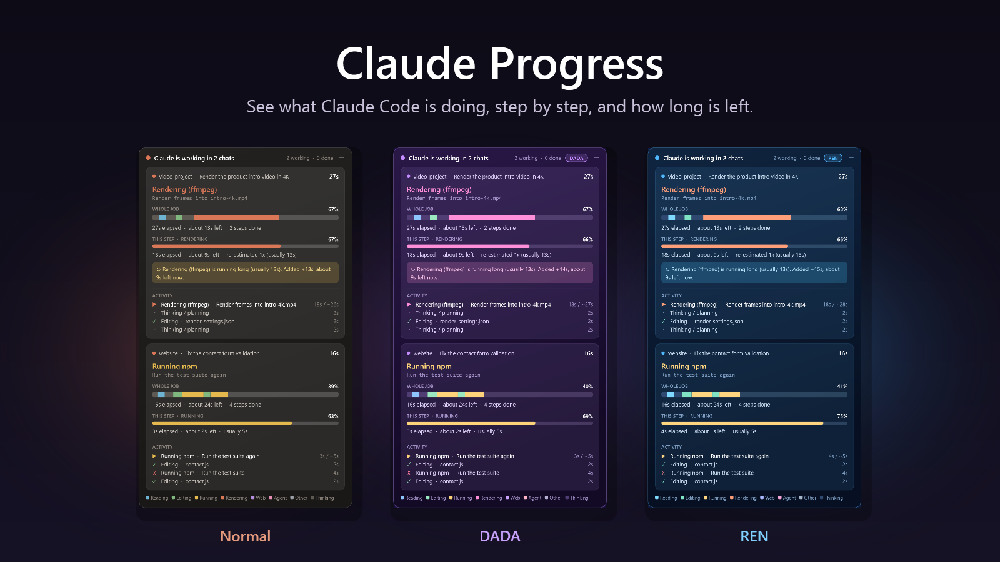
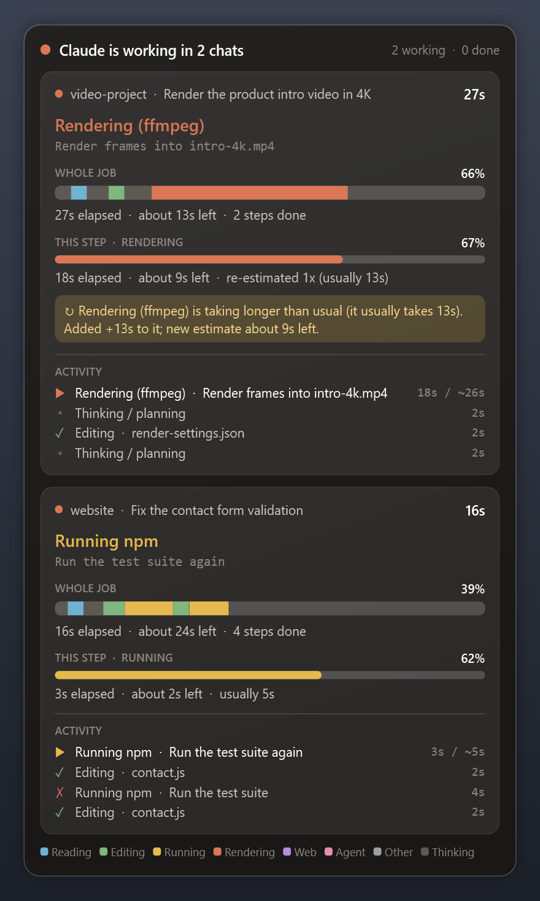
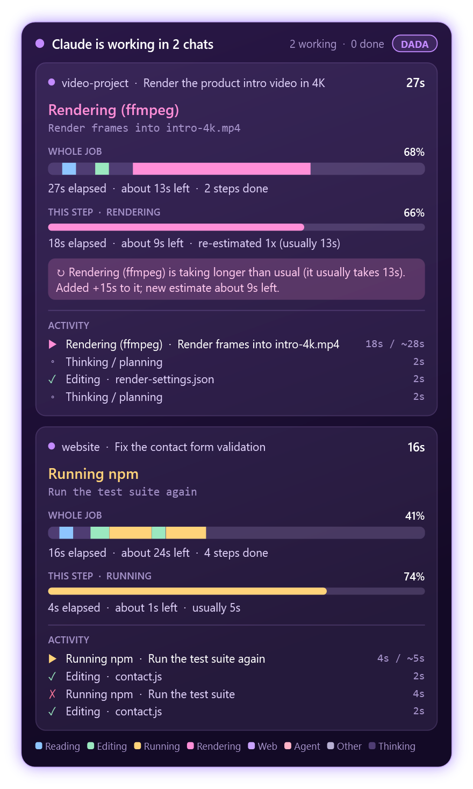

<div align="center">



# Claude Progress

**A live progress window for Claude on Windows: Claude Code and regular chats.**<br>
See what Claude is doing right now, where the time went, and roughly how long is left.


[Quick start](#-quick-start) · [Features](#-features) · [Themes](#-themes) · [Options](#%EF%B8%8F-options) · [How it works](#-how-it-works) · [FAQ](#-faq)

</div>

---

## 🚀 Quick start

1. **Download** this repo: green **Code** button → **Download ZIP**, then unzip it.
2. **Double-click `Install.cmd`.**
3. **Restart Claude** (or open a new session). That's it: the window appears whenever Claude works.

> [!TIP]
> Want to see it first? Double-click **`Try Demo.cmd`**. It plays two fake chats and installs nothing.

## ✨ Features

| | |
| --- | --- |
| 🔍 **What's happening now** | Reading, editing, running a command, rendering, browsing, with the actual file name or command underneath. |
| 🌈 **Timeline bar** | The whole job as coloured segments, so you can see where the time went, including time Claude spent thinking. |
| ⏱️ **Honest estimates** | "Time left" is learned from how long similar steps took before. It never sticks at 99%: when a step runs long, the bar eases back, the extra time moves onto that step, and a note tells you why. |
| 🗂️ **One card per chat** | Every Claude chat that's working gets its own progress card, labelled with its folder and your message. |
| 💬 **Code and regular chats** | Claude Code sessions are tracked step by step through hooks. Regular chats in the Claude desktop app get a card too, with the chat name, its current step and a learned estimate. |
| ✅ **Activity list** | Each step with ✓ or ✗, how long it took, and what's running now. |
| 🎨 **Themes, sizes, modes** | Normal, DADA and REN themes · Small to Extra large (or Ctrl + scroll) · Saver, Neutral and Full power. |
| ➖ **Minimize** | Folds down into a slim bar toward the button you clicked, with the percent, time left and a thin progress line. |
| 🌊 **Smooth motion** | Bars glide continuously; new steps, notices and chats grow open and enter in a gentle stagger instead of popping in. |
| 🔢 **Calm numbers** | Fixed-width digits, so timers and percentages count without wobbling, and status lines never strand a lone word. |
| 🔒 **Private** | Everything stays on your computer. Nothing is sent anywhere. |

## 🎨 Themes

Right-click the window → **Theme**.

<table>
  <tr>
    <th>Normal</th>
    <th>DADA</th>
    <th>REN</th>
  </tr>
  <tr>
    <td></td>
    <td></td>
    <td></td>
  </tr>
  <tr>
    <td>Warm charcoal with orange accents</td>
    <td>Deep purple with a violet glow</td>
    <td>Midnight blue with a cyan glow</td>
  </tr>
</table>

## ⚙️ Options

Right-click the window for everything. Drag it anywhere; it remembers its place and your settings.

| Menu | Choices |
| --- | --- |
| **Minimize** | slim bar mode (also the **–** button, or double-click the window) |
| **Theme** | Normal · DADA · REN |
| **Performance** | Saver · Neutral · Full power |
| **Size** | Small · Medium · Large · Extra large (or hold **Ctrl** and scroll) |
| **Show activity details** | the step list and colour legend |
| **Show regular Claude chats** | also track chats in the Claude desktop app (on by default) |
| **Hide when Claude is idle** | only show the window while Claude works |
| **Sound when a long job finishes** | a chime after jobs longer than 30 seconds |

### Minimized


### Performance modes

Measured with the built-in two-chat demo:

| Mode | CPU while Claude works | Memory | You get |
| --- | --- | --- | --- |
| 🍃 **Saver** | ~3% | ~55–70 MB | no animation, no glow, updates every 1.5 s |
| ⚖️ **Neutral** *(default)* | ~17% | ~80–90 MB | smooth motion at 40 fps |
| 🚀 **Full power** | ~18% | ~200 MB | smoothest, 60 fps, updates every 0.25 s |

When Claude is idle and the window is hidden, it uses almost nothing.

## 🧠 How it works

```
Claude Code ──hook events──▶ hook.js ──writes──▶ state.json ◀──reads── ClaudeProgress window
                                     └──────────▶ history.json  (past step times → estimates)
```

The installer registers `hook.js` as a Claude Code [hook](https://docs.claude.com/en/docs/claude-code/hooks) for these events:

| Hook | Meaning |
| --- | --- |
| `UserPromptSubmit` | a job starts |
| `PreToolUse` | a step starts |
| `PostToolUse` / `PostToolUseFailure` | a step ends (or fails) |
| `Stop` | the job is finished |

`hook.js` records what's happening in `%USERPROFILE%\.claude-progress\state.json` and keeps the last 12 durations of each kind of step in `history.json`. A file lock keeps several chats from overwriting each other. The hook never prints anything and always exits successfully, so it can never block or slow down Claude.

Regular chats have no hooks, so `chat-watch.ps1` reads the Claude desktop app's window through Windows UI Automation: a chat whose sidebar entry says **Running** is replying, and the open chat's step line ("Searching the web") becomes the current step. It reports through `hook.js`, so chats become cards like any Code session, and chat reply times are learned separately. It only reads the **Claude** tab; while you're on the Code tab, running chats are kept as they were until you switch back (or for up to 10 minutes).
The window (`ClaudeProgress.ps1`) is WPF running in Windows PowerShell 5.1, so there's nothing extra to install beyond Node.js.

<details>
<summary><b>What the installer changes</b></summary>

- Copies the app to `%LOCALAPPDATA%\ClaudeProgress`
- Adds five hooks to `~/.claude/settings.json`. A backup is saved first as `settings.json.before-claude-progress.bak`, and your other settings and hooks are kept. Running it twice doesn't duplicate anything.
- Adds Start menu shortcuts (**Claude Progress**, **Claude Progress Demo**, **Uninstall Claude Progress**)
- Starts the app with Windows

</details>

<details>
<summary><b>Files in this repo</b></summary>

| File | What it is |
| --- | --- |
| `ClaudeProgress.ps1` | the window |
| `hook.js` | the hook Claude Code runs; records steps and timings |
| `chat-watch.ps1` | watches regular chats in the Claude desktop app |
| `settings-hooks.js` | adds or removes the hooks in `~/.claude/settings.json` |
| `demo.js` | plays two fake chats for the demo |
| `install.ps1`, `Install.cmd` | installer |
| `uninstall.ps1`, `Uninstall.cmd` | uninstaller |
| `Try Demo.cmd` | runs the demo without installing |
| `screenshots/` | images for this page |

</details>

## ❓ FAQ

**The window isn't showing.**
If **Hide when Claude is idle** is on, it only appears while Claude is working. Otherwise open **Claude Progress** from the Start menu. It also starts automatically when you sign in.

**It says "no estimate yet (learning)".**
That's the first time it has timed that kind of step. After one run it has a time to go on, and estimates get better with use.

**Does it slow Claude down?**
No. The hook takes about 50 ms per step, never prints anything and always exits successfully.

**Does it work with regular Claude chats, not just Claude Code?**
Yes, in the Claude desktop app. Chats show their name, current step and time left. They don't show file names or commands, because regular chat doesn't share those. Turn it off with right-click → **Show regular Claude chats**.
**Does it work with several Claude chats at once?**
Yes. Each working chat gets its own card.

**How do I remove it?**
Start menu → **Claude Progress** → **Uninstall Claude Progress** (or run `Uninstall.cmd`). It closes the window, removes only its own hooks and deletes the app and shortcuts. Your timing history in `%USERPROFILE%\.claude-progress` stays; delete that folder if you like.

## 📄 License

[MIT](LICENSE) © 2026 nyuwawen
