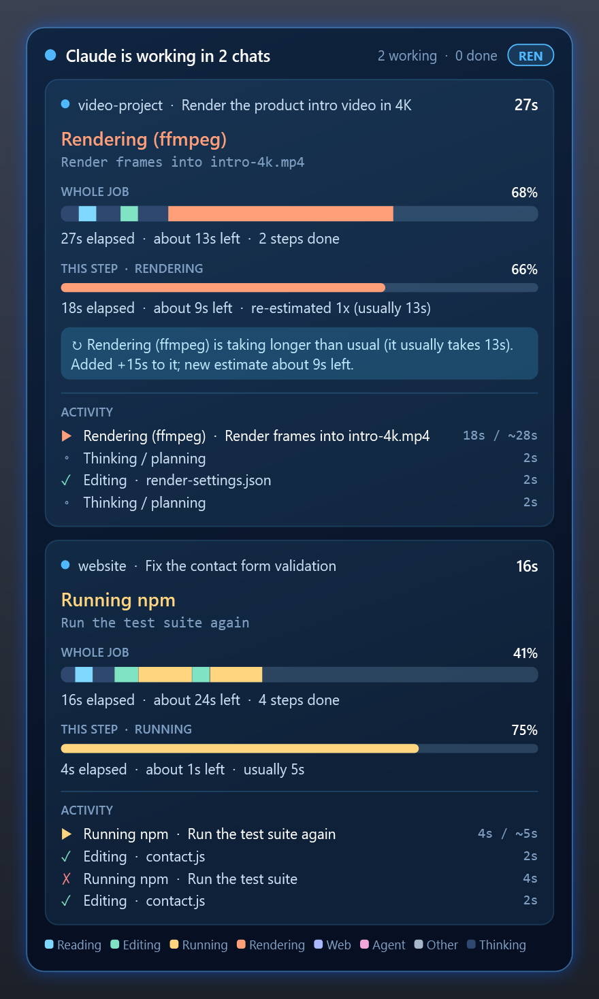

# Claude Progress

A small always-on-top Windows window that shows what **Claude Code** is doing right now, step by step, how long it has been working and roughly how long is left.

  
  
  

## Features

- **Live step-by-step view**: what Claude is doing now (reading, editing, running a command, rendering, browsing) with the file name or command.
- **Timeline bar**: the whole job as coloured segments, so you can see where the time went, including time spent thinking.
- **Honest estimates**: time left is learned from how long similar steps took before. When a step runs long the bar never sticks at 99%; it re-estimates, pulls the bar back and tells you why.
- **One card per chat**: every Claude chat that is working gets its own progress card.
- **Activity list**: each step with ✓ / ✗, how long it took, and what is running now.
- **Themes**: Normal, **DADA** (purple) and **REN** (blue).
- **Resizable**: Small to Extra large, or Ctrl + scroll.
- **Performance modes**: Saver, Neutral and Full power.
- Optional sound when a long job finishes, and an option to hide the window while Claude is idle.

## Requirements

- Windows 10 or 11
- [Node.js](https://nodejs.org) (Claude Code already needs it)
- [Claude Code](https://claude.com/claude-code) (CLI or the desktop app's Code tab)

## Install

1. Download this repository (green **Code** button > **Download ZIP**) and unzip it.
2. Double-click **Install.cmd**.
3. Restart Claude (or start a new session).

The installer:
- copies the app to `%LOCALAPPDATA%\ClaudeProgress`
- adds five hooks to `~/.claude/settings.json` (a backup is saved next to it as `settings.json.before-claude-progress.bak`; your other settings and hooks are kept)
- adds Start menu shortcuts (the app, a demo, an uninstaller) and starts the app with Windows

Want to see it first without installing anything? Double-click **Try Demo.cmd**.

## Using it

Right-click the window for all options:

| Menu | Options |
| --- | --- |
| Theme | Normal, DADA (purple), REN (blue) |
| Performance | Saver, Neutral, Full power |
| Size | Small, Medium, Large, Extra large (or hold Ctrl and scroll) |
| Show activity details | the step list and colour legend |
| Hide when Claude is idle | only show the window while Claude works |
| Sound when a long job finishes | a chime after jobs longer than 30 seconds |

Drag the window anywhere; it remembers its place and your settings.

### Performance modes

Measured with the built-in two-chat demo:

| Mode | CPU while Claude works | RAM | What you get |
| --- | --- | --- | --- |
| Saver | ~3% | ~55–70 MB | no animation, no glow, updates every 1.5 s |
| Neutral (default) | ~17% | ~80–90 MB | smooth motion at 40 fps |
| Full power | ~18% | ~200 MB | smoothest, 60 fps, updates every 0.25 s |

While Claude is idle and the window is hidden it uses almost nothing.

## How it works

Claude Code can run a command on certain events ([hooks](https://docs.claude.com/en/docs/claude-code/hooks)). The installer registers `hook.js` for:

| Hook | Meaning |
| --- | --- |
| `UserPromptSubmit` | a job starts |
| `PreToolUse` | a step starts |
| `PostToolUse` / `PostToolUseFailure` | a step ends (or fails) |
| `Stop` | the job is finished |

`hook.js` writes what is happening to `%USERPROFILE%\.claude-progress\state.json` and keeps the last 12 durations of each kind of step in `history.json`. The window (`ClaudeProgress.ps1`, WPF via Windows PowerShell) reads that file and draws it. The hook never prints anything and always exits successfully, so it can never block or slow down Claude.

Everything stays on your computer; nothing is sent anywhere.

## Uninstall

Start menu > **Claude Progress** > **Uninstall Claude Progress** (or run `Uninstall.cmd`). It closes the window, removes only its own hooks from your settings, and deletes the app and shortcuts. Your timing history in `%USERPROFILE%\.claude-progress` is kept; delete that folder if you like.

## Files

| File | What it is |
| --- | --- |
| `ClaudeProgress.ps1` | the window |
| `hook.js` | the hook Claude Code runs; records steps and timings |
| `settings-hooks.js` | adds or removes the hooks in `~/.claude/settings.json` |
| `demo.js` | plays two fake chats for the demo |
| `install.ps1`, `Install.cmd` | installer |
| `uninstall.ps1`, `Uninstall.cmd` | uninstaller |
| `Try Demo.cmd` | runs the demo without installing |

## License

MIT, see [LICENSE](LICENSE).
